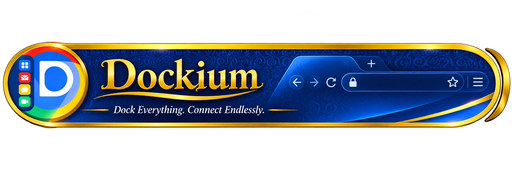
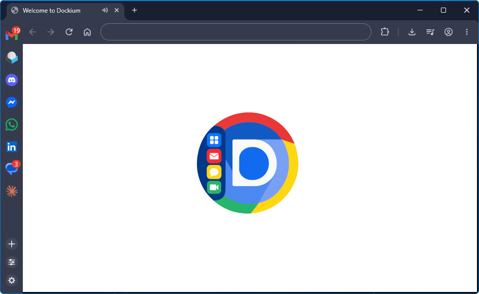
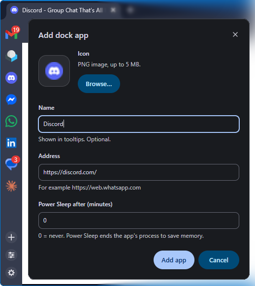
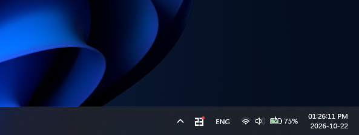
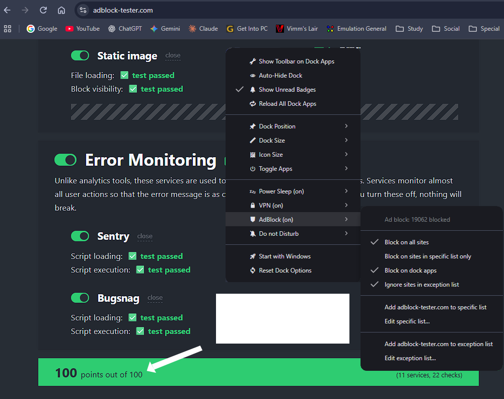
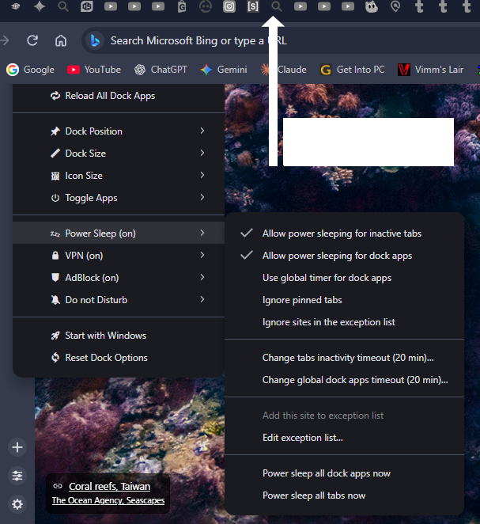
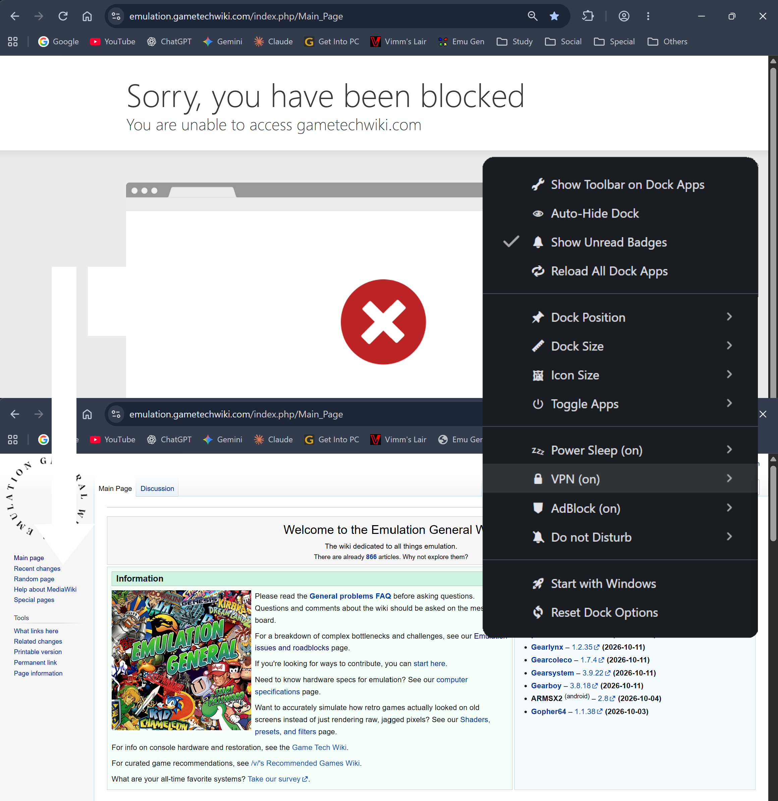
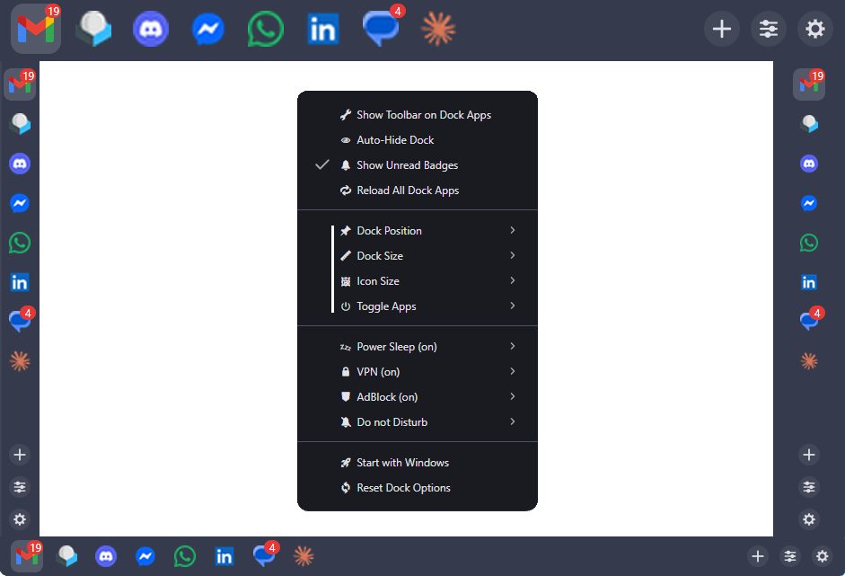

  

 

<table align="center">
<tr>
<td align="center" width="40%">

</td>
<td align="left" width="60%">

<h1> 🌐 Dockium 🌐 </h1>
<b>Dock Everything. Connect Endlessly.</b>

## ✨ Overview

**Dockium** is the ultimate Chromium browser for elite power users. Dock your world, isolate your accounts, and enjoy a background-first, live-updated workspace engineered to keep you endlessly connected.

It blends **productivity, privacy, and performance** into one seamless browser.

</td>
</tr>
</table>

 

---

---

## 🌟 Features

⚓ **Dock Everything**  
Press **+** to dock your essential sites and social channels into dedicated, session-isolated dock apps, always one click away and always active in the background.

🔔 **Out of Sight. But Never Out of Touch.**  
Close the browser and stay distraction-free. Dockium keeps running in your system tray, processes incoming alerts in real time, and shows your total unread count right where you need it.

😴 **Power Sleep**  
A custom, aggressive discard engine freezes inactive tabs, reducing RAM and CPU usage to virtually zero. Tabs stay in your bar as lightweight shells with their full history and reload instantly when you return.

🛡️ **Rust-Powered Adblocker**
Enjoy distraction-free web apps with an adblocker powered by high-speed Rust performance. Whether you are browsing normally or working inside docked sidebar sessions, keep every page clean and fast with customizable domain-level controls.

🧅 **Anonymous Browsing on Your Terms**
Take complete control of your online presence with integrated Tor routing. Route your entire connection or assign specific proxy rules per site and docked app. Choose your preferred exit country, auto-route for optimal speed, or plug in your own custom VPN/proxy server—giving you elite-level privacy with zero extra cost.

🎛️ **Your Dock, Your Way**  
Move the dock anywhere you like, then fine-tune its width and icon size until it feels exactly right.

---

## ⚙️ How It Works

- 🧩 **Chromium** > The most popular browser base. With exception of Google API stuff, fully compatible with all standard Chrome features.
- ⚓ **Session-isolated dock apps** > Each dock app have it's own session, Allow multiple same active website each with its own account.
- 🔔 **System tray service** > Closing the browser will simply dock it into the tray in form of counter counting total unread notifications.
- 🦀 **Rust Adblocker** > Powers the high-speed adblock engine easily customizable to use for all or specific websites.  
- 🧅 **Tor / proxy VPN routing** > Handles per-site and global privacy customizable to use for all or specific websites.

---

## 🖼️ Screenshots & Guide

  

<table align="center">
<tr>
<td align="center" width="50%" valign="top">

<b>⚓ Dock Everything</b>

Dock any website as its own app with a <b>fully isolated session</b>. Docked apps stay <b>always alive</b> in the background and show a <b>red badge</b> with the total number of notifications.

<ul align="left">
  <li>➕ <b>Add Button (+)</b>: docks the current site as its own app</li>
  <li>🔴 <b>Red Badge</b>: live count of all unread notifications</li>
  <li>🔐 <b>Separate Sessions</b>: cookies and logins never mix between apps</li>
</ul>

</td>
<td align="center" width="50%" valign="top">

<b>🔔 System Tray</b>

Closing the browser window docks Dockium into the tray instead of quitting. It stays alive and shows a <b>counter of all unread items across your docked apps</b>.

<ul align="left">
  <li>📥 <b>Close to Tray</b>: the browser keeps running in the background</li>
  <li>🔢 <b>Unified Counter</b>: one tray badge for every dock app</li>
  <li>⚡ <b>Instant Restore</b>: click the tray icon to bring everything back</li>
</ul>

</td>
</tr>
<tr>
<td align="center" width="50%" valign="top">

<b>🛡️ Adblocker</b>

A built-in adblocker that works in both normal tabs and docked sessions.

<ul align="left">
  <li>🌐 <b>Per-Domain Control</b>: enable or disable blocking for each site</li>
  <li>⚓ <b>Works in Docks</b>: docked apps can have their own rules</li>
  <li>🚀 <b>Faster Pages</b>: less clutter and fewer trackers</li>
</ul>

</td>
<td align="center" width="50%" valign="top">

<b>😴 Power Sleep</b>

Save RAM and battery without losing your place.

<ul align="left">
  <li>🧊 <b>Auto Freeze</b>: inactive tabs are put to sleep automatically</li>
  <li>⚡ <b>Instant Reload</b>: tabs wake up the moment you return</li>
  <li>🔋 <b>Lower Usage</b>: noticeably less CPU and memory</li>
</ul>

</td>
</tr>
<tr>
<td align="center" width="50%" valign="top">

<b>🧅 VPN</b>

Built-in privacy routing, no extensions needed.

<ul align="left">
  <li>🧅 <b>Tor Routing</b>: route everything, or set rules per site and docked app</li>
  <li>🌍 <b>Exit Country</b>: pick a country or let Dockium auto-route for speed</li>
  <li>🔌 <b>Custom Proxy / VPN</b>: add your own server for full control</li>
</ul>

</td>
<td align="center" width="50%" valign="top">

<b>🎛️ Your Dock, Your Way</b>

Make the dock fit your workflow.

<ul align="left">
  <li>📐 <b>Flexible Position</b>: move the dock to any side of the window</li>
  <li>↔️ <b>Adjustable Width</b>: slim or wide, your choice</li>
  <li>🖼️ <b>Icon Size</b>: scale icons to match your screen</li>
</ul>

</td>
</tr>
</table>

---

## 📥 Installation & Tutorial

**Step 1:** Download from **Releases** or clone the repository  

**Step 2:** Run the Dockium installer  

**Step 3:** Launch Dockium and follow the welcome tour  

**Step 4:** Press **+** to dock your first site  

**Step 5:** Dock your world and stay endlessly connected ⚓  

> ⚠️ Dockium is still under development. Please report any issue you find on the [Issues](../../issues) page.

---

## 📦 Credits

- 👨‍💻 Author → MDJ-Github (Me ^_^)
- 🧩 Engine → [Chromium](https://www.chromium.org/)
- 🧅 Anonymity → [Tor Project](https://www.torproject.org/)
- 🦀 Adblock → Rust

---

## 🚀 Final Note

We are excited for you to start using Dockium! More features are on the way, and because Dockium is still under development, please report any issue you find on our GitHub page. Have fun re-exploring the web!

  

<b>Dock Everything. Connect Endlessly.</b>

